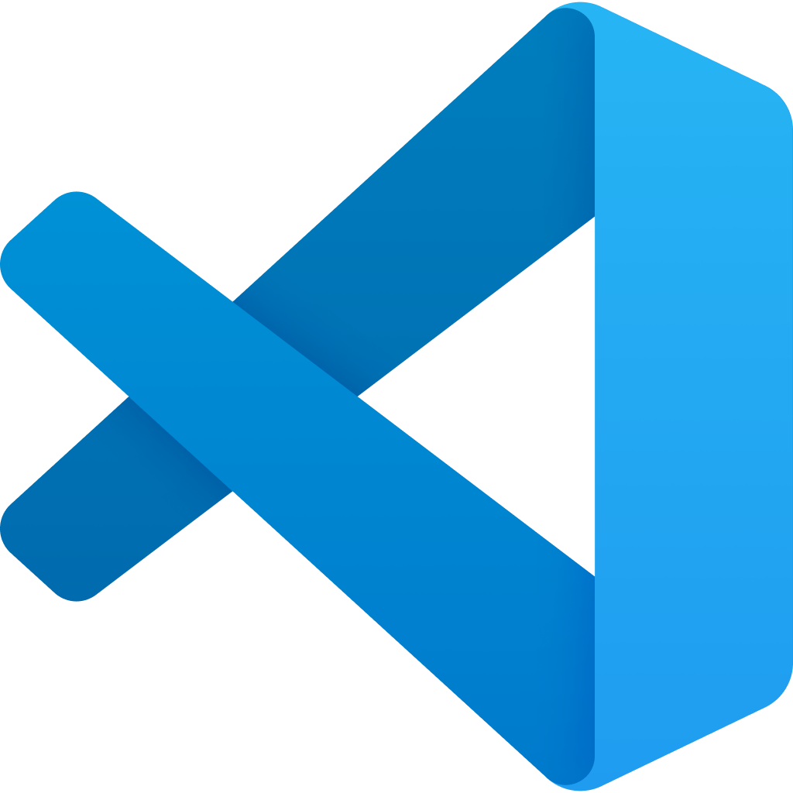
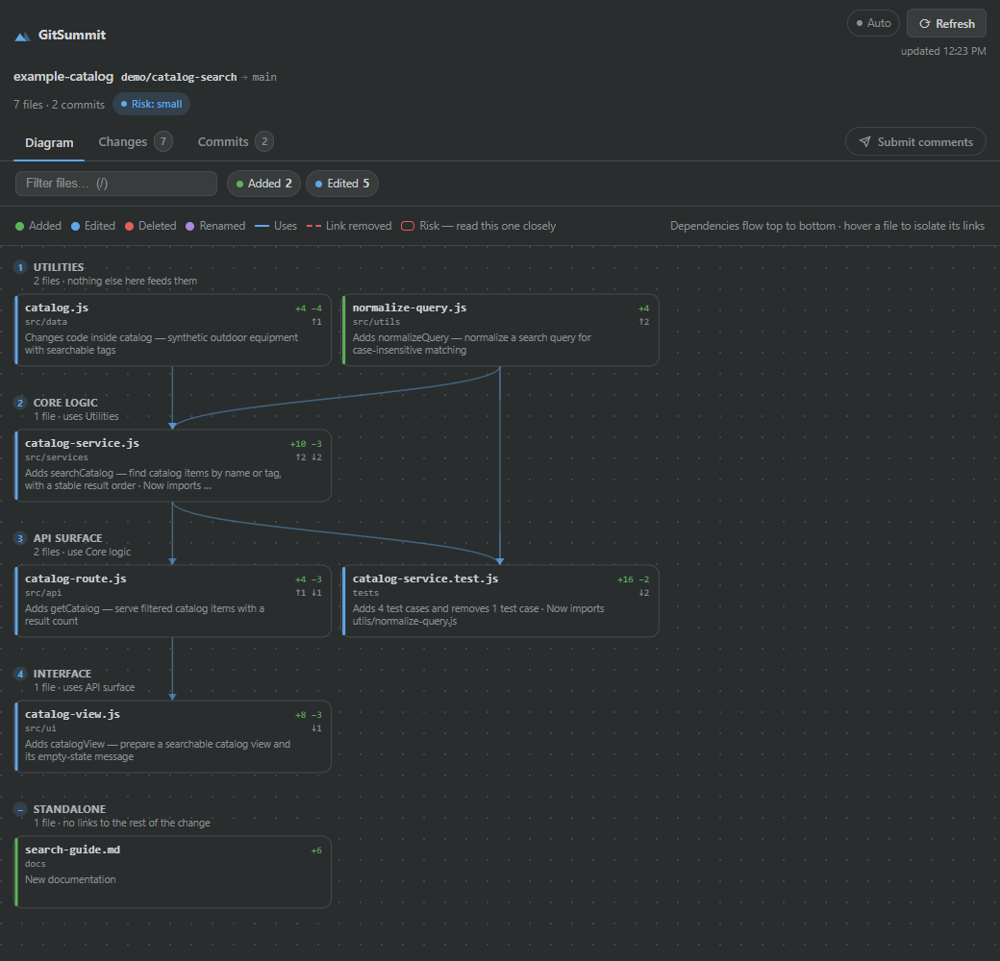
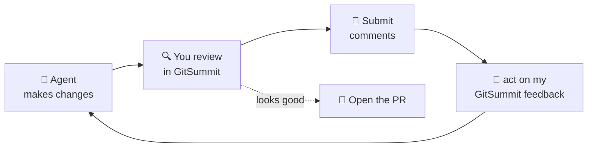
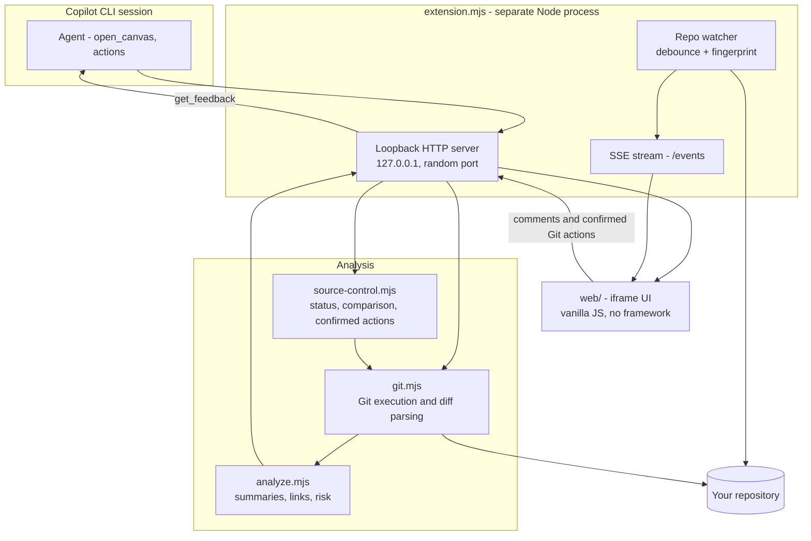

<div align="center">


# GitSummit

### See your code. Understand your changes.

**A visual review canvas for you and your coding agent.** Explore inferred
dependencies, read change summaries, assess potential impact, and leave inline
feedback your agent can act on - all alongside your Git workflow.

*Community-built for canvas-capable GitHub Copilot hosts.
Not an official GitHub product or endorsement.*

</div>

---

## ⚡ Quick start

<p>
  <a href="https://github.com/github/app">
    <picture>
      <source media="(prefers-color-scheme: dark)" srcset="docs/icons/copilot-dark.svg" />
      
    </picture>
  </a>
  &nbsp;&nbsp;&nbsp;&nbsp;
  <a href="https://code.visualstudio.com/"></a>
</p>

In the **GitHub Copilot app** or **Visual Studio Code** chat, send the prompt below.
Use **Agent** mode in VS Code.

```text
install this canvas https://github.com/nimrod-rozenman/GitSummit-Canvas/tree/main/.github/extensions/gitsummit
```

Approve the installation prompts. Then ask **Open GitSummit**.
Viewing the canvas requires a host with canvas-extension support.

---

## 🧠 From diff to decision

**Understand your code changes - not just the lines that changed.**

GitSummit brings a visual graph, readable summaries, inferred dependencies,
and change-impact signals into one shared review canvas. Its main purpose is
to make your changes easier to understand, whether you wrote them or an agent did.

> **See how the pieces connect. Understand the impact. Review the details.**

Explore changed files as a graph, then follow their inferred connections into
the diff. File summaries explain what changed. Ask Copilot in chat for
LLM-generated summaries and deeper explanations while you inspect the code.

Impact and risk analysis highlight changes that deserve attention: removed
declarations, dependency updates, large edits, and files with many changed
dependents. Each risk score includes its reasons.

Review a file as a whole or leave inline comments on specific lines. Then ask
the agent to act on your feedback, keeping the discussion tied to the code
you are reviewing.

The canvas's built-in summaries, dependency links, and impact signals use local
text-based heuristics. LLM-generated explanations come from Copilot in chat.
These signals guide review; they do not prove correctness, security, or test coverage.

---

## 🗺️ The four tabs

All screenshots use synthetic code and commits from `example-catalog`, with no personal account details.

### Source Control - manage your changes


- Stage or unstage individual files, then inspect the diff below.
- Commit staged changes with confirmation.
- Compare incoming and outgoing commits using cached remote refs.
- Sync from origin's default branch. A green border marks incoming commits. Sync never pushes.

Sync requires a clean worktree and fast-forwardable history.
See [Git actions and safety rules](.github/extensions/gitsummit/README.md#source-control) for Fetch, Pull, Push, and sync details.

### 🕸️ Diagram - see how it connects



- Explore changed files in a graph of inferred dependencies.
- See file summaries, change counts, and risk markers.
- Hover over a file to highlight its connections.
- Click a file to open its diff, then return to the graph.

### 📄 Changes - review the details


- Read file summaries and the reasons behind each risk score.
- Switch between changed hunks, whole-file context, and full-screen review.
- Leave file-level or inline comments for the agent.
- Choose **Triage**, **List**, or **Layers** to set your review order.

### 📜 Commits - follow the story


- Follow the branch's commit timeline.
- See which directories contain the most changes.
- Click a directory to filter the **Changes** view.

---

## 🎯 Risk - a heuristic that shows its work

Every file gets **Risk: none / small / medium / high**. It is a *heuristic*, so it is never presented as a verdict - **every point carries its own reason**, printed right on the card.

| Signal | Why it counts |
| :-- | :-- |
| 🗑️ the whole file is removed | remaining imports may need changes |
| ✂️ removes declarations | callers may depend on the removed API |
| 🔗 N changed files depend on it | blast radius *inside this very change* |
| 📦 moved / renamed | every import pointing at it must change |
| 📈 large change, many deletions | more surface area to get wrong |
| ⚙️ dependency manifest or CI edit | breaks the **build**, not just the code |
| 🧪 no changed test is linked to it | the heuristic found no related test in this change |

The header shows the change-wide risk: the worst file, nudged up for each additional notable one.

---

## 🔍 Filtering that can't hide the scary file

One filter bar applies to the **three review tabs**: a search box plus
**Added / Edited / Deleted / Renamed** chips.

The **High risk** chip is deliberately *not* another `AND`. It is an **override** - it shows every flagged file regardless of the other filters, which grey themselves out while it is on.

> **Why:** so nothing risky can hide behind a filter you forgot was set.

---

## 💬 Review comments → straight back to the agent

Comment on a whole file, or on any individual line in a diff. Comments live in the canvas for the length of the review - **nothing is written into your repository**.

**Submit comments** prepares Markdown grouped by file and attempts to copy it to
the clipboard. The agent can read comments with `get_feedback`. This does not
post a review or comment to GitHub. The feedback flow is:



After submitting, you literally just say:

> *"act on my GitSummit feedback"*

---

## 🔄 Auto-update that doesn't fight your editor

Source Control refreshes local status every eight seconds while visible and Auto
is enabled. Its snapshots use working-file content hashes and staged Git entries.

GitSummit watches the repository and recomputes when its Git fingerprint changes.

Filesystem events are debounced for 400 ms. A fingerprint of HEAD and porcelain
status reduces redundant updates. It is not a content digest: another edit to an
already-modified file may require **Refresh**. Refreshing preserves the selected
tab, expanded files, and scroll position.

The extension uses recursive `fs.watch` where supported, with a four-second poll
as a fallback. Watching runs while a canvas event-stream client is connected.
The **Auto** toggle pauses automatic UI refresh; it does not stop the server's
watcher.

---

## 🧬 How the comparison base is chosen

In priority order:

```
explicit override  →  origin/HEAD (the remote's default branch)  →  first of main / master / develop / trunk
```

GitSummit then compares the **working tree** - committed **+** staged **+** unstaged - against the **merge-base** with that ref. Untracked files the agent just created are folded in as new-file additions, so work-in-progress shows up too.

---

## 🤖 Agent-facing API

**Open input** (`open_canvas` with `canvasId: "gitsummit"`):

| Field | Type | What it does |
| --- | --- | --- |
| `base` | `string` | Force a comparison base, e.g. `"main"` |
| `focus` | `string` | Open straight to a specific file |

**Actions:**

| Action | What it does |
| --- | --- |
| `refresh` | Recompute from current git state and push the update to the canvas |
| `set_base` | Change the comparison base, then refresh |
| `focus_file` | Switch to **Changes**, expand a file, scroll to it |
| `get_feedback` | Read the reviewer's comments back as markdown |
| `source_status` | Read local state and a remote-ref comparison without fetching or changing Git |

`source_status` accepts an optional `ref` naming an existing remote-tracking
branch. Git mutations are exposed through the canvas UI, not as agent actions.

---

## ⌨️ Keyboard shortcuts

| | | | |
| :-: | --- | :-: | --- |
| <kbd>0</kbd> | Source Control | <kbd>Ctrl+Enter</kbd> | Preview a commit from the message box |
| <kbd>1</kbd> | Diagram | <kbd>/</kbd> | Focus the filter |
| <kbd>2</kbd> | Changes | <kbd>r</kbd> | Refresh |
| <kbd>3</kbd> | Commits | <kbd>Esc</kbd> | Close the full-screen diff |

Shortcuts do not intercept typing in input fields. Escape also cancels an open
Git-operation confirmation.
With a tab focused, use Left/Right arrows, Home, or End to change views.
The header, tab row, and toolbar stay aligned. Each view preserves its reading
position. Short transitions respect reduced-motion preferences.

---

## 🏗️ Architecture



| File | Purpose |
| --- | --- |
| [`extension.mjs`](.github/extensions/gitsummit/extension.mjs) | Canvas registration, loopback HTTP server, event stream, watcher, and agent actions |
| [`git.mjs`](.github/extensions/gitsummit/git.mjs) | Git introspection and unified-diff parsing |
| [`source-control.mjs`](.github/extensions/gitsummit/source-control.mjs) | Local status, remote comparisons, and confirmed Git actions |
| [`http-guard.mjs`](.github/extensions/gitsummit/http-guard.mjs) | Per-panel token and loopback request validation |
| [`source-control.test.mjs`](.github/extensions/gitsummit/source-control.test.mjs) | Integration tests using disposable local Git remotes |
| [`analyze.mjs`](.github/extensions/gitsummit/analyze.mjs) | Heuristic summaries, links, and risk |
| [`web/app.js`](.github/extensions/gitsummit/web/app.js) | Interactive review UI |
| [`web/styles.css`](.github/extensions/gitsummit/web/styles.css) | Shared dark palette and review layout |
| [`web/source-control.js`](.github/extensions/gitsummit/web/source-control.js) | Source Control interactions and confirmations |
| [`web/source-control.css`](.github/extensions/gitsummit/web/source-control.css) | Stacked Source Control layout |
| [`web/index.html`](.github/extensions/gitsummit/web/index.html) | Canvas document |

The extension uses Node built-ins and the host-provided Copilot SDK. No build step
is required. Its dependency links and risk scores are text-based heuristics,
not a resolved code graph, a security audit, or evidence that tests passed.

---

## 🔒 Privacy and data flow

- **Runtime repository data is sensitive.** The canvas reads paths, diffs, file
  contents, commit messages, and author names from the workspace it reviews.
  It does not automatically redact them.
- **Review data is local to the extension process.** The UI uses a per-instance
  HTTP server bound to `127.0.0.1`. Review comments are held in memory and can be
  returned to the host agent or copied to the clipboard.
- **Requests are protected, not sandboxed.** Local API endpoints require a
  per-panel token and reject cross-origin requests. Do not expose or forward the
  port. Use trusted repositories and local software.
- **Confirmed Git actions can send data.** Fetch, pull, push, and sync contact
  the configured Git remote. Push sends commits and their contents. Review the
  repository, destination, and commands before confirming.
- **Git changes persist.** Staging updates the index, committing creates a
  commit, and pulling can update working files. Comments and bounded Git Output
  are held in memory. Unsubmitted message drafts reset with the panel.
- **Other tools have their own policies.** Git uses the current user's
  authentication, hooks, and signing configuration. Git terminal prompts and
  Git Credential Manager interactivity are disabled. Other configured askpass
  or SSH helpers may still prompt. Failures and timeouts appear in the UI.
  Inspect Git state before retrying a timed-out operation. Host processing,
  clipboard synchronization, editors, and Git helpers are separate. Remote URL
  credentials are redacted, but source code and messages are not.

Do not publish screenshots, logs, review exports, or recordings from a work or
customer repository. Use a synthetic example and follow the
[screenshot guidance](docs/screenshots/README.md).

Before making a fork or release public, inspect all branches, tags, historical
blobs, commit attribution, commit trailers, and hosted assets. Removing a value
from the latest file does not remove it from Git history. Confirm that you have
the right to publish the code; a content scan cannot establish ownership.

---

## 🎨 Theme

All four tabs share Source Control's dark background and inset colors rather
than inheriting the host theme.

---

## 📋 Requirements

| | |
| --- | --- |
| **Host** | a GitHub Copilot host with canvas extension support |
| **Node** | 20 or later |
| **git** | on `PATH` |
| **OS** | Windows · macOS · Linux |

## Validation

From `.github/extensions/gitsummit`, run:

```text
node --test source-control.test.mjs
```

Tests create disposable local repositories and remotes. They do not change your
current repository or contact an external remote. Set `GITSUMMIT_TEST_ROOT` to
choose where to keep the test fixtures. The symlink test reports a skip if the
account lacks permission to create symbolic links.

## License

No license has been selected for this repository. Public visibility alone does
not grant permission to reuse or redistribute its code. The owner must confirm
publication rights and select a license before presenting it as open source.
Third-party icons retain their own [licenses and usage terms](docs/icons/README.md).

---

<div align="center">

**Built for the moment between _"the agent is done"_ and _"ship it"_.**

</div>
