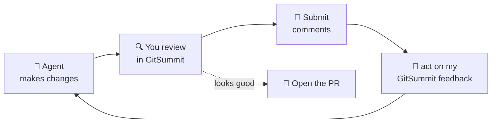
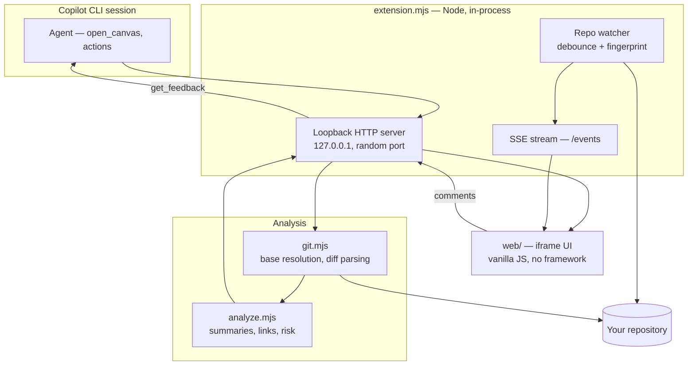

<div align="center">


# GitSummit

### The last look before the pull request.

**A Copilot CLI canvas that turns "the agent changed 23 files" into a change you can actually read** — grouped by how the files depend on each other, ranked by what looks most likely to break, with review comments you hand straight back to the agent.

[](https://github.com/nimrod-rozenman/GitSummit-Canvas)
[](#-how-the-comparison-base-is-chosen)
[](#-architecture)
[](#-what-it-never-does)
[](#-requirements)


</div>

---

## 🧭 The problem

An agent finishes a task and hands you a diff. `git diff` shows you *lines*. A PR view shows you *files, alphabetically*. Neither tells you the thing you actually need before you press **Create pull request**:

> **What did this change actually touch, in what order does it make sense to read it, and which file is going to bite me?**

GitSummit answers exactly that — in the gap between *"agent is done"* and *"PR is open"*.

It is **repo-agnostic**: it inspects whatever workspace the Copilot session is running in, entirely through `git`. No language server, no network calls, no per-project configuration, nothing to set up.

---

## ⚡ Quick start

**1. Install the extension** — point the app's extension installer at this folder:

```
https://github.com/nimrod-rozenman/GitSummit-Canvas/tree/main/.github/extensions/gitsummit
```

<details>
<summary><b>…or install it by hand</b></summary>

Copy `.github/extensions/gitsummit/` into either:

| Scope | Path |
| --- | --- |
| **User** (every project) | `~/.copilot/extensions/gitsummit/` |
| **Project** (this repo only) | `<repo>/.github/extensions/gitsummit/` |

Then reload extensions — or just restart the session.

</details>

**2. Let an agent make some changes.**

**3. Ask for it:**

```
open GitSummit
```

That's it. No install step, no build step, no config file. The canvas opens beside the chat, reads the repository, and renders.

<div align="center">

</div>

---

## 🗺️ The three tabs

<table>
<tr>
<td width="33%" valign="top">

### `1` Diagram

**How the change fits together.**

</td>
<td width="33%" valign="top">

### `2` Changes

**What each file did, riskiest first.**

</td>
<td width="34%" valign="top">

### `3` Commits

**The story of the branch.**

</td>
</tr>
</table>

### 🕸️ Diagram — the shape of the change


A top-to-bottom flow. Changed files are grouped into **layers** by how they depend on each other: the top layer depends on nothing else in the change, each layer below uses the one above it, and files with no links land in **Standalone**. Layers are named after the file the rest of the layer leans on — `Data access` → `Core logic` → `Tests`.

Every card carries the filename, its directory, line counts, `↑used-by` / `↓uses` degrees and a one-line description.

| | |
| --- | --- |
| **Solid arrow** | *uses* — points **downward**, from a dependency into the file that consumes it |
| **Dashed red arrow** | a link this change **removed** |
| **Ringed card** | flagged: read this one closely |
| **Hover** | isolates a file and everything it touches |
| **Click** | jumps to it in **Changes**, with a `↩ Back to diagram` button waiting |

### 📄 Changes — file by file


Each changed file is a card: status, name, risk, directory, counts, a 1–3 sentence summary, signal chips (`+ createRateLimiter`, `− resetWindow`, `+ ioredis`) and the plain-language reasons behind its risk score.

Three groupings, one click apart:

- **Triage** *(default)* — riskiest first: **Read closely** → **Worth a look** → **Routine**
- **List** — flat, ordered by churn
- **Layers** — the Diagram's ordering, so you read the change in the order it was built

Expand a card and you get a toolbar: **Changed hunks / Whole file** · **⤢ Full screen** · **↗ Open file** (launches your editor) · **＋ Comment**.

### 📜 Commits — where the work went


The branch's commit narrative, plus a directory rollup showing where the change is concentrated. Click a directory to filter **Changes** down to it.

---

## 🎯 Risk — a heuristic that shows its work

Every file gets **Risk: none / small / medium / high**. It is a *heuristic*, so it is never presented as a verdict — **every point carries its own reason**, printed right on the card.

| Signal | Why it counts |
| :-- | :-- |
| 🗑️ the whole file is removed | anything still importing it breaks |
| ✂️ removes declarations | callers lose an API they were using |
| 🔗 N changed files depend on it | blast radius *inside this very change* |
| 📦 moved / renamed | every import pointing at it must change |
| 📈 large change, many deletions | more surface area to get wrong |
| ⚙️ dependency manifest or CI edit | breaks the **build**, not just the code |
| 🧪 no test in this change covers it | nothing proves it still works |

The header shows the change-wide risk: the worst file, nudged up for each additional notable one.

---

## 🔍 Filtering that can't hide the scary file

One filter bar, applied to **every** tab: a search box plus **Added / Edited / Deleted / Renamed** chips.

The **High risk** chip is deliberately *not* another `AND`. It is an **override** — it shows every flagged file regardless of the other filters, which grey themselves out while it is on.

> **Why:** so nothing risky can hide behind a filter you forgot was set.

---

## 💬 Review comments → straight back to the agent

Comment on a whole file, or on any individual line in a diff. Comments live in the canvas for the length of the review — **nothing is written into your repository**.

Hit **Submit comments** (top right) and they're rendered as markdown, grouped by file. The agent reads them back through the `get_feedback` action, so the whole loop is:



After submitting, you literally just say:

> *"act on my GitSummit feedback"*

---

## 🔄 Auto-update that doesn't fight your editor

GitSummit watches the repository and recomputes **only when it actually changed**.

Filesystem events are debounced (400 ms) and then checked against a cheap fingerprint of the working tree — so editor temp files, save churn and git's own index rewrites never trigger a redraw. Refreshing **keeps your place**: same tab, same expanded files, same scroll position.

Recursive `fs.watch` where it's supported, automatic fallback to a 4-second fingerprint poll where it isn't. Watching only runs while somebody is actually looking. The **Auto** toggle turns it all off.

---

## 🧬 How the comparison base is chosen

In priority order:

```
explicit override  →  origin/HEAD (the remote's default branch)  →  first of main / master / develop / trunk
```

GitSummit then compares the **working tree** — committed **+** staged **+** unstaged — against the **merge-base** with that ref. Untracked files the agent just created are folded in as new-file additions, so work-in-progress shows up too.

---

## 🤖 Agent-facing API

**Open input** (`open_canvas` with `canvasId: "gitsummit"`):

| Field | Type | What it does |
| --- | --- | --- |
| `base` | `string` | Force a comparison base, e.g. `"main"` |
| `focus` | `string` | Open straight to a specific file |

**Actions:**

| Action | What it does |
| --- | --- |
| `refresh` | Recompute from current git state and push the update to the canvas |
| `set_base` | Change the comparison base, then refresh |
| `focus_file` | Switch to **Changes**, expand a file, scroll to it |
| `get_feedback` | Read the reviewer's comments back as markdown |

---

## ⌨️ Keyboard shortcuts

| | | | |
| :-: | --- | :-: | --- |
| <kbd>1</kbd> | Diagram | <kbd>/</kbd> | Focus the filter |
| <kbd>2</kbd> | Changes | <kbd>r</kbd> | Refresh |
| <kbd>3</kbd> | Commits | <kbd>Esc</kbd> | Close the full-screen diff |

---

## 🏗️ Architecture



| File | Lines | Purpose |
| --- | --: | --- |
| [`extension.mjs`](.github/extensions/gitsummit/extension.mjs) | 485 | Wiring: `joinSession`, the canvas, a per-instance loopback HTTP server, SSE, the repo watcher, the agent actions |
| [`git.mjs`](.github/extensions/gitsummit/git.mjs) | 511 | Repo-agnostic git introspection and unified-diff parsing |
| [`analyze.mjs`](.github/extensions/gitsummit/analyze.mjs) | 529 | Turns a diff into summaries, links between changed files, and risk |
| [`web/app.js`](.github/extensions/gitsummit/web/app.js) | 1,624 | The interactive UI |
| [`web/styles.css`](.github/extensions/gitsummit/web/styles.css) | 1,816 | The **Graphite** palette |
| [`web/index.html`](.github/extensions/gitsummit/web/index.html) | 107 | Shell |

**~5,000 lines. Zero runtime dependencies. No build step.** Everything is derived from `git` output alone — which is what keeps it repo-agnostic, and also why nothing is presented as fact: summaries are descriptive, and every risk point carries its own reason.

---

## 🔒 What it never does

- ❌ **Never writes to your repository.** Review comments live in memory for the life of the canvas and disappear with it.
- ❌ **Never talks to the network.** The HTTP server binds to `127.0.0.1` on a random port, one instance per canvas.
- ❌ **Never becomes a file launcher.** `↗ Open file` only opens paths that are part of the current change.
- ❌ **Never keeps durable state.** The repository is the source of truth; the rundown is recomputed on open, on refresh, and on repo change.

---

## 🎨 Theme

GitSummit ships its own palette — **Graphite** — rather than inheriting the host theme, so it looks identical in every app theme, light or dark.

---

## 📋 Requirements

| | |
| --- | --- |
| **Copilot CLI** | with canvas extension support |
| **Node** | ≥ 20 *(recursive `fs.watch`; older versions fall back to polling)* |
| **git** | on `PATH` |
| **OS** | Windows · macOS · Linux |

---

<div align="center">

**Built for the moment between _"the agent is done"_ and _"ship it"_.**

</div>
