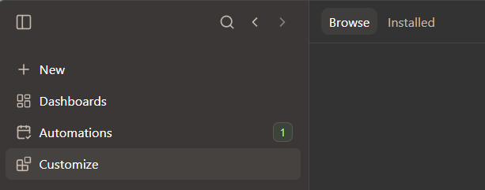
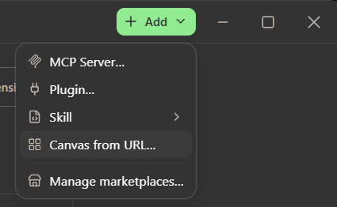
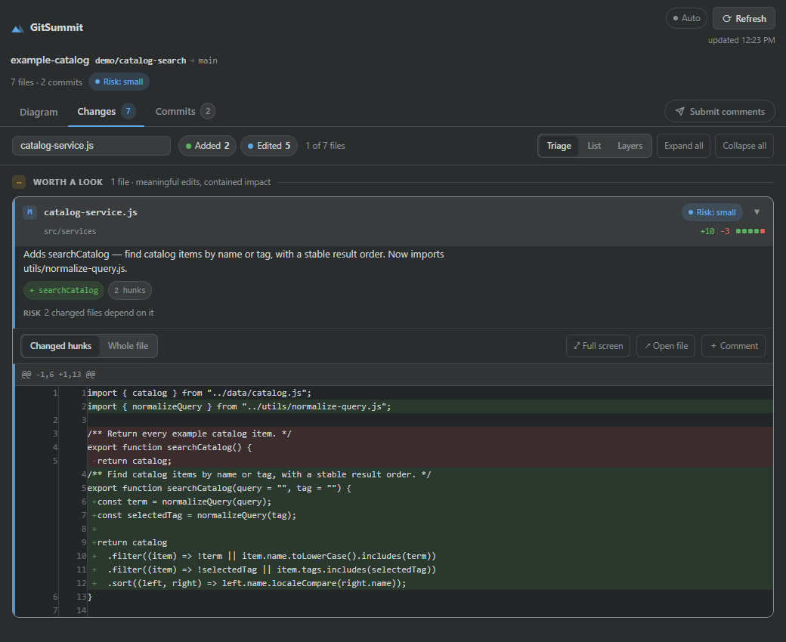
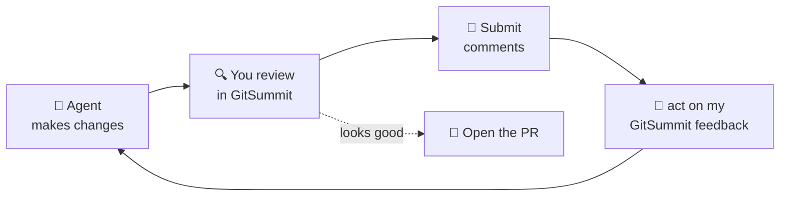
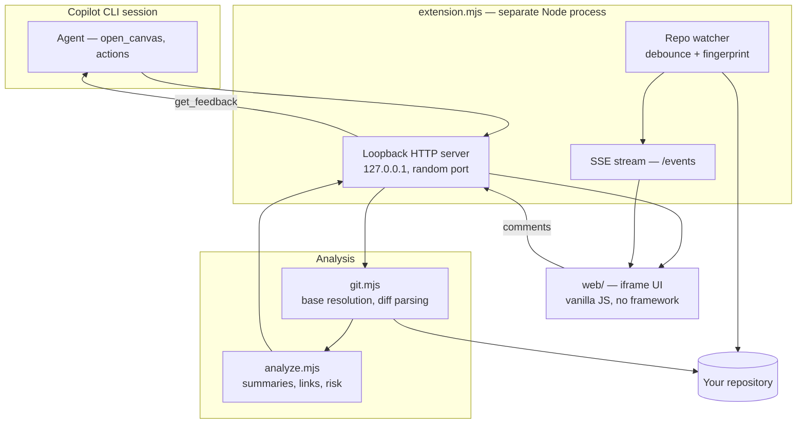

<div align="center">


# GitSummit

### The last look before the pull request.

**A repository-independent review canvas for a canvas-capable GitHub Copilot host.**
Inspect changed files, follow inferred dependencies, and give the agent review feedback.

This is a community extension, not an official host feature or an endorsement by
the host's vendor.

</div>

---

## ⚡ Quick start

**1. Open the GitHub Copilot app. Select Customize in the sidebar.**



**2. Select Add → Canvas from URL…**



**3. Paste this URL:**

```text
https://github.com/nimrod-rozenman/GitSummit-Canvas/tree/main/.github/extensions/gitsummit
```

Complete the installation prompts. Choose **User** scope if asked.

**4. Open a project session. Send this message:**

```text
Open GitSummit
```

GitSummit opens beside the chat and shows your project's changes.
If the project has no changes, there is nothing to review yet.
You only install once. In another project session, ask **Open GitSummit** again.

No terminal commands or build step are required.
If the repository is private, your GitHub account needs access.

<details>
<summary>Manual installation</summary>

Copy the `.github/extensions/gitsummit/` folder from this repository to one of these locations:

| Scope | Path |
| --- | --- |
| **User** (every project) | `~/.copilot/extensions/gitsummit/` |
| **Project** (one project) | `<your-project>/.github/extensions/gitsummit/` |

Restart the session. Then ask **Open GitSummit**.
The host must support canvas extensions.

</details>

---

## 🧭 The problem

An agent finishes a task and hands you a diff. `git diff` shows you *lines*. A PR view shows you *files, alphabetically*. Neither tells you the thing you actually need before you press **Create pull request**:

> **What did this change actually touch, in what order does it make sense to read it, and which file is going to bite me?**

GitSummit answers exactly that — in the gap between *"agent is done"* and *"PR is open"*.

It inspects the active session's Git workspace. Its analysis uses local Git output
and file contents rather than a language server or a project-specific service.
The version in this repository provides review views; it does not provide
stage, commit, fetch, pull, or push controls.

---

## 🗺️ The three tabs

The screenshots below use a synthetic `example-catalog` repository.
All code, names, and commits are demonstration data. These are canvas-only
captures, without account details or the host app's sidebar.

<table>
<tr>
<td width="33%" valign="top">

### `1` Diagram

**How the change fits together.**

</td>
<td width="33%" valign="top">

### `2` Changes

**What each file did, riskiest first.**

</td>
<td width="34%" valign="top">

### `3` Commits

**The story of the branch.**

</td>
</tr>
</table>

### 🕸️ Diagram — the shape of the change


A top-to-bottom flow. Changed files are grouped into **layers** by how they depend on each other: the top layer depends on nothing else in the change, each layer below uses the one above it, and files with no links land in **Standalone**. Layers are named after the file the rest of the layer leans on — `Data access` → `Core logic` → `Tests`.

Every card carries the filename, its directory, line counts, `↑used-by` / `↓uses` degrees and a one-line description.

| | |
| --- | --- |
| **Solid arrow** | *uses* — points **downward**, from a dependency into the file that consumes it |
| **Dashed red arrow** | a link this change **removed** |
| **Ringed card** | flagged: read this one closely |
| **Hover** | isolates a file and everything it touches |
| **Click** | jumps to it in **Changes**, with a `↩ Back to diagram` button waiting |

### 📄 Changes — file by file



Each changed file is a card: status, name, risk, directory, counts, a 1–3 sentence summary, signal chips (`+ createRateLimiter`, `− resetWindow`, `+ ioredis`) and the plain-language reasons behind its risk score.

Three groupings, one click apart:

- **Triage** *(default)* — riskiest first: **Read closely** → **Worth a look** → **Routine**
- **List** — flat, ordered by churn
- **Layers** — the Diagram's ordering, so you read the change in the order it was built

Expand a card for **Changed hunks / Whole file**, **Full screen**, **Open file**,
and **Comment**. Open file first requests the host's editor canvas. If that is
unavailable, it can fall back to an installed editor or the system file handler.

### 📜 Commits — where the work went


The branch's commit narrative, plus a directory rollup showing where the change is concentrated. Click a directory to filter **Changes** down to it.

---

## 🎯 Risk — a heuristic that shows its work

Every file gets **Risk: none / small / medium / high**. It is a *heuristic*, so it is never presented as a verdict — **every point carries its own reason**, printed right on the card.

| Signal | Why it counts |
| :-- | :-- |
| 🗑️ the whole file is removed | remaining imports may need changes |
| ✂️ removes declarations | callers may depend on the removed API |
| 🔗 N changed files depend on it | blast radius *inside this very change* |
| 📦 moved / renamed | every import pointing at it must change |
| 📈 large change, many deletions | more surface area to get wrong |
| ⚙️ dependency manifest or CI edit | breaks the **build**, not just the code |
| 🧪 no changed test is linked to it | the heuristic found no related test in this change |

The header shows the change-wide risk: the worst file, nudged up for each additional notable one.

---

## 🔍 Filtering that can't hide the scary file

One filter bar, applied to **every** tab: a search box plus **Added / Edited / Deleted / Renamed** chips.

The **High risk** chip is deliberately *not* another `AND`. It is an **override** — it shows every flagged file regardless of the other filters, which grey themselves out while it is on.

> **Why:** so nothing risky can hide behind a filter you forgot was set.

---

## 💬 Review comments → straight back to the agent

Comment on a whole file, or on any individual line in a diff. Comments live in the canvas for the length of the review — **nothing is written into your repository**.

**Submit comments** prepares Markdown grouped by file and attempts to copy it to
the clipboard. The agent can read comments with `get_feedback`. This does not
post a review or comment to GitHub. The feedback flow is:



After submitting, you literally just say:

> *"act on my GitSummit feedback"*

---

## 🔄 Auto-update that doesn't fight your editor

GitSummit watches the repository and recomputes when its Git fingerprint changes.

Filesystem events are debounced for 400 ms. A fingerprint of HEAD and porcelain
status reduces redundant updates. It is not a content digest: another edit to an
already-modified file may require **Refresh**. Refreshing preserves the selected
tab, expanded files, and scroll position.

The extension uses recursive `fs.watch` where supported, with a four-second poll
as a fallback. Watching runs while a canvas event-stream client is connected.
The **Auto** toggle pauses automatic UI refresh; it does not stop the server's
watcher.

---

## 🧬 How the comparison base is chosen

In priority order:

```
explicit override  →  origin/HEAD (the remote's default branch)  →  first of main / master / develop / trunk
```

GitSummit then compares the **working tree** — committed **+** staged **+** unstaged — against the **merge-base** with that ref. Untracked files the agent just created are folded in as new-file additions, so work-in-progress shows up too.

---

## 🤖 Agent-facing API

**Open input** (`open_canvas` with `canvasId: "gitsummit"`):

| Field | Type | What it does |
| --- | --- | --- |
| `base` | `string` | Force a comparison base, e.g. `"main"` |
| `focus` | `string` | Open straight to a specific file |

**Actions:**

| Action | What it does |
| --- | --- |
| `refresh` | Recompute from current git state and push the update to the canvas |
| `set_base` | Change the comparison base, then refresh |
| `focus_file` | Switch to **Changes**, expand a file, scroll to it |
| `get_feedback` | Read the reviewer's comments back as markdown |

---

## ⌨️ Keyboard shortcuts

| | | | |
| :-: | --- | :-: | --- |
| <kbd>1</kbd> | Diagram | <kbd>/</kbd> | Focus the filter |
| <kbd>2</kbd> | Changes | <kbd>r</kbd> | Refresh |
| <kbd>3</kbd> | Commits | <kbd>Esc</kbd> | Close the full-screen diff |

---

## 🏗️ Architecture



| File | Purpose |
| --- | --- |
| [`extension.mjs`](.github/extensions/gitsummit/extension.mjs) | Canvas registration, loopback HTTP server, event stream, watcher, and agent actions |
| [`git.mjs`](.github/extensions/gitsummit/git.mjs) | Git introspection and unified-diff parsing |
| [`analyze.mjs`](.github/extensions/gitsummit/analyze.mjs) | Heuristic summaries, links, and risk |
| [`web/app.js`](.github/extensions/gitsummit/web/app.js) | Interactive review UI |
| [`web/styles.css`](.github/extensions/gitsummit/web/styles.css) | Graphite palette and layout |
| [`web/index.html`](.github/extensions/gitsummit/web/index.html) | Canvas document |

The extension uses Node built-ins and the host-provided Copilot SDK. No build step
is required. Its dependency links and risk scores are text-based heuristics,
not a resolved code graph, a security audit, or evidence that tests passed.

---

## 🔒 Privacy and data flow

- **Runtime repository data is sensitive.** The canvas reads paths, diffs, file
  contents, commit messages, and author names from the workspace it reviews.
  It does not automatically redact them.
- **Review data is local to the extension process.** The UI uses a per-instance
  HTTP server bound to `127.0.0.1`. Review comments are held in memory and can be
  returned to the host agent or copied to the clipboard.
- **Loopback is not a security boundary.** This review-only version does not
  authenticate its local HTTP endpoints. Do not expose or forward its port.
  Use it only with repositories and local software you trust.
- **No upload or remote Git operation is built into this version.** Host
  processing, clipboard synchronization, editors, and configured Git helpers
  have their own behavior and policies. Local analysis is not a guarantee that
  information returned to the host stays on this computer.
- **No commit or source-edit action is exposed.** Comments are not saved in the
  repository. Open file can launch an editor; changes made there are separate
  user actions.

Do not publish screenshots, logs, review exports, or recordings from a work or
customer repository. Use a synthetic example and follow the
[screenshot guidance](docs/screenshots/README.md).

Before making a fork or release public, inspect all branches, tags, historical
blobs, commit attribution, commit trailers, and hosted assets. Removing a value
from the latest file does not remove it from Git history. Confirm that you have
the right to publish the code; a content scan cannot establish ownership.

---

## 🎨 Theme

GitSummit ships its own palette — **Graphite** — rather than inheriting the host theme, so it looks identical in every app theme, light or dark.

---

## 📋 Requirements

| | |
| --- | --- |
| **Host** | a GitHub Copilot host with canvas extension support |
| **Node** | 20 or later |
| **git** | on `PATH` |
| **OS** | Windows · macOS · Linux |

## License

No license has been selected for this repository. Public visibility alone does
not grant permission to reuse or redistribute its code. The owner must confirm
publication rights and select a license before presenting it as open source.

---

<div align="center">

**Built for the moment between _"the agent is done"_ and _"ship it"_.**

</div>
